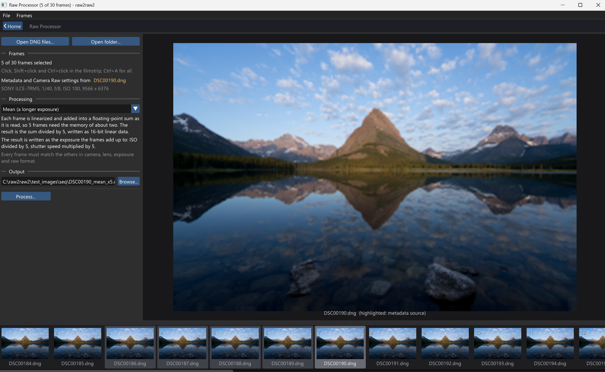
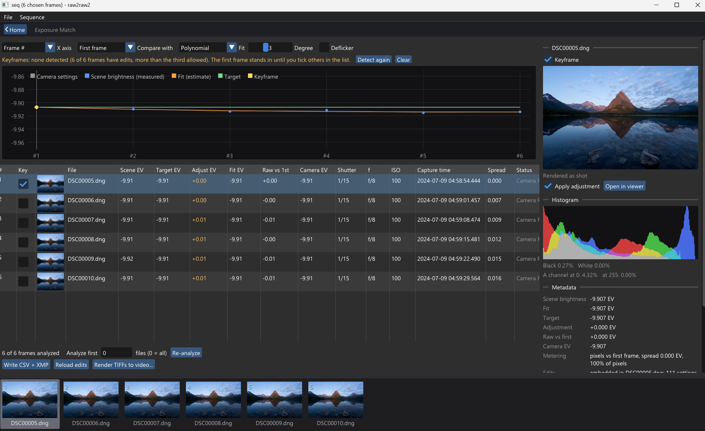

# Open Landscape Photography Tools

This is a set of software tools that I have wished I had over the past 10-15 years of my landscape photography journey. My goal for this project is to create an open-source set of tools for other landscape photographers, developed by landscape photographers.

As of now, this library is not a dedicated image editor like Photoshop. Rather, it is a set of tools that automate several workflows I find very helpful. It is designed to work with a range of existing image editors. Currently supported editors are:
- [Photoshop](https://photoshop.adobe.com)
- [Lightcraft](https://github.com/storytold/lightcraft)

Other editors that can edit raw files should be easy to support using a custom processing server. Note that most of these tools require at least one editor to be installed. Users are fully responsible for the licensing and terms of whichever external tool they choose to use.

### Features
This project is still a work in progress, and not all of my planned features are implemented (not even counting community-suggested ones). Video demo instructions may be provided on request, or in the future when I have more time.

#### Raw-to-Raw Processor

A processor that performs calculations on raw files directly and outputs a fully editable raw file. The currently implemented features are the Mean and Median filters.
- **Mean:** Simulates a raw long exposure by taking the mean of the pixels in multiple images shot in short sequence. You may use an intervalometer or burst mode. This can also simulate ISOs lower than most cameras' base ISO of 100, and can replace the need for ND filters.
- **Median:** Removes crowds or reduces noise by taking the median of the pixels in multiple images.
Note that this feature does not require a raw editor.

#### Sequence Light Metering and Batch Export (as part of a future end-to-end timelapse engine)

Meters every raw frame in a time-lapse sequence and fits a smooth brightness curve through a few keyframes you have edited, which removes flicker and the camera's exposure steps. It then writes XMP sidecars so Camera Raw and Lightroom can carry your keyframe edits to every frame in the sequence.

Batch Export uses an image editor of your choice to export these XMP settings into a tiff sequence, which can then be rendered into a video. These will be core parts of a future end-to-end timelapse engine.

### Usage and Building From Source
Currently, only Windows is supported, as the project uses Adobe's open-source [DNG SDK](https://helpx.adobe.com/security/products/dng-sdk.html). For build instructions and documentation of the code, see [BuildInstructions.md](BuildInstructions.md).

### About Me
I have been a landscape photographer for the past 10-15 years, since I was a teenager. My portfolio can be seen [here](https://jonah-chen.github.io/) (still WIP ~5 years behind, as I have been quite busy and I am not a great web developer). I have never been a professional photographer, and I do not organize any paid tours. I am also a researcher in theoretical multi-agent reinforcement learning, hence I am not the best programmer.
